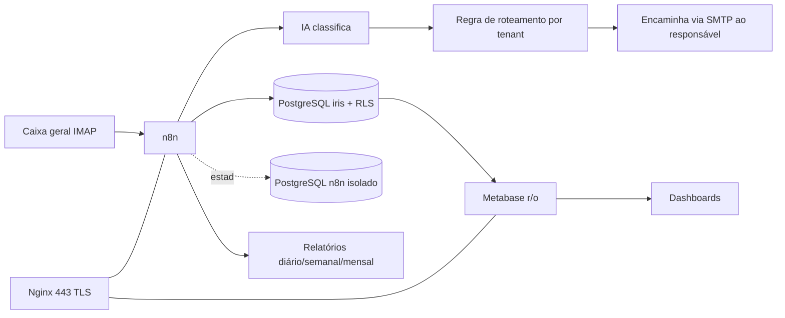

# TRD — ÍRIS

| Campo | Valor |
|---|---|
| Documento | TRD (Requisitos Técnicos) |
| Versão | 1.0 · 09/10/2026 |
| Referências | PRD ÍRIS v1.0 · documento-mestre v0.1 (§3, §5, §6, §7, §13) · Manual ARKHEN ARK-MAN-001 v1.4 (cap. 7, 8, 11) |

> Detalhe de arquitetura, docker-compose, segurança e infraestrutura está no documento-mestre v0.1 (§5 a §13). Este TRD é o **índice técnico** do Kit: fixa a stack, os padrões e os ADRs, e aponta para o mestre.

## 1. Stack escolhida

Stack **aprovada** da ARKHEN (alinhada ao AMORA). Fora dela, só com ADR.

| Camada | Tecnologia | Motivo |
|---|---|---|
| Orquestração | **n8n** (banco próprio isolado) | Fluxos visuais de captura, classificação, roteamento e relatórios; já pré-instalado no VPS n8n da HostGator |
| Entrada / saída de e-mail | **IMAP (leitura) + SMTP (envio)** — nó nativo do n8n | Funciona no Gmail/Titan comum com **senha de app** (2FA). Ver ADR-0007 |
| Classificação | **Modelo de IA via API** (nó de IA do n8n) | IA sugere; saída validada por JSON Schema. Provedor em ADR-0005 (pendente) |
| Banco de dados | **PostgreSQL 16** com **RLS forçado** | Relacional, RLS nativo, padrão ARKHEN. Dois bancos: `iris` (negócio) e `n8n` (isolado) |
| BI / dashboards | **Metabase** (usuário somente leitura) | Padrão aprovado (AMORA); exploração e relatório sem código; cabe nos 8 GB. Mantido — ver análise no histórico do projeto |
| Borda / TLS | **Nginx** + Let's Encrypt (Certbot) | Reverse proxy; só 443 público; HSTS |
| Empacotamento | **Docker Compose** | Toda a stack sobe junta; segredos no `.env` |
| Hospedagem | **VPS HostGator / Ubuntu Server LTS**, 4 vCPU / 8 GB RAM | `[A CONFIRMAR root + Docker + datacenter BR]` (PD do mestre §1.3) |
| CI/CD | GitHub Actions (org `ArkhenTecnologia`, repo privado `arkhen-iris`) | Padrão ARKHEN |
| Monitoramento | Sentry (ou alerta de falha de workflow no n8n) | Obrigatório antes de publicar |

## 2. Arquitetura

Diagrama completo no mestre §5. Resumo:

- **Padrão de integração:** não há API REST pública própria no MVP; a orquestração é no n8n. Integrações externas (IMAP, SMTP, LLM) via camada anticorrupção (porta + adaptador + `vinculo_externo`).
- **Formato de erro (quando houver endpoint):** `{ "error": { "code": "CODIGO", "message": "texto que orienta", "requestId": "..." } }`
- **Validação:** saída da IA validada por **JSON Schema/Zod** antes de gravar ou encaminhar.
- **Multi-cliente:** **sim** — `tenant_id` + **RLS forçado** (ADR-0006). Ver `05-esquema-backend.md`.
- **Offline-first:** não se aplica (serviço de servidor).

## 3. APIs e serviços externos

| Serviço | Uso | Dados pessoais enviados | Observação |
|---|---|---|---|
| IMAP (Gmail/Titan) | ler a caixa geral | e-mail, assunto, corpo | senha de app; credenciais no `.env` |
| SMTP (Gmail/Titan) | encaminhar ao responsável | e-mail, conteúdo | idem |
| Provedor de IA `[Vertex AI × OpenAI — PD-03]` | classificar | assunto/corpo | **transferência internacional** se OpenAI → entra no RIPD e no inventário LGPD |
| Sentry | monitorar erros | nenhum (mascarar) | obrigatório antes de publicar |

Todo serviço que recebe dado pessoal entra em `docs/lgpd/inventario-dados.md`.

## 4. Principais endpoints

O MVP não expõe API REST própria. Pontos de acesso:

| Acesso | Função | Autenticação |
|---|---|---|
| Painel Metabase (`/bi`) | dashboards e relatórios | login Metabase + MFA; usuário por tenant |
| n8n (`/iris`) | administração de fluxos | restrito por VPN/allowlist + MFA |
| Webhook n8n (se usado) | gatilhos internos | token; nunca porta pública além do 443 |

Endpoints de direitos do titular (LGPD) e `/health` entram quando/se houver camada de aplicação — registrar aqui ao criar.

## 5. Padrões e regras para a IA (padrão ARKHEN)

- Domínio, testes e comentários em **português**; estados/eventos em `snake_case`, iguais ao DDL.
- `.env` só local (no `.gitignore`) e `.env.example` versionado; nunca credenciais no código.
- Usuários de banco por privilégio mínimo: `iris_owner` (DDL/migração), `iris_app` (DML pelo n8n), `iris_ro` (leitura, Metabase). Ver mestre §7.
- Testes: todo teste visto falhando antes de passar; **teste de isolamento multi-tenant obrigatório no CI**.
- Segurança: checklist do Manual 8.3; saída de IA validada; conteúdo de e-mail é dado, não instrução.
- **Nenhuma biblioteca/serviço novo sem justificativa neste TRD.**
- Commits pequenos e separados por natureza; PR com CI verde; Conventional Commits; SemVer.

## 6. Decisões técnicas (ADR)

Os ADR-0001 a 0005 vêm do mestre §3; 0006 e 0007 são fechados aqui.

| ADR | Decisão | Consequência (ganha / perde / obriga) | Status |
|---|---|---|---|
| 0001 | Sem backend customizado; lógica no n8n + banco | − código/manutenção / + disciplina de migração / migrações versionadas pelo dono | Aceita |
| 0002 | n8n com banco próprio isolado | falha do n8n não contamina o negócio / dois bancos / backup e credenciais separados | Aceita |
| 0003 | Tempo derivado de log append-only | auditabilidade / duração vem de view / nenhum `UPDATE` destrutivo em `eventos_email` | Aceita |
| 0004 | IA só sugere; saída validada | robustez contra alucinação / não classificável vai à triagem humana / validar toda saída | Aceita |
| 0005 | Provedor de IA | critério custo + LGPD (dado no Brasil) | **Proposta — PD-03** |
| 0006 | **Multi-tenant** (`tenant_id` + RLS forçado) | produto vendável a vários clientes / modelo de dados mais complexo / teste de isolamento no CI, DPA por cliente | **Aceita** |
| 0007 | Captura por **IMAP+SMTP com senha de app** | simples, funciona no Gmail/Titan comum / senha de app a gerir e rotacionar / migrar para Gmail API (OAuth) se precisar de rótulos/escala | **Aceita** (alternativa Gmail API documentada) |
