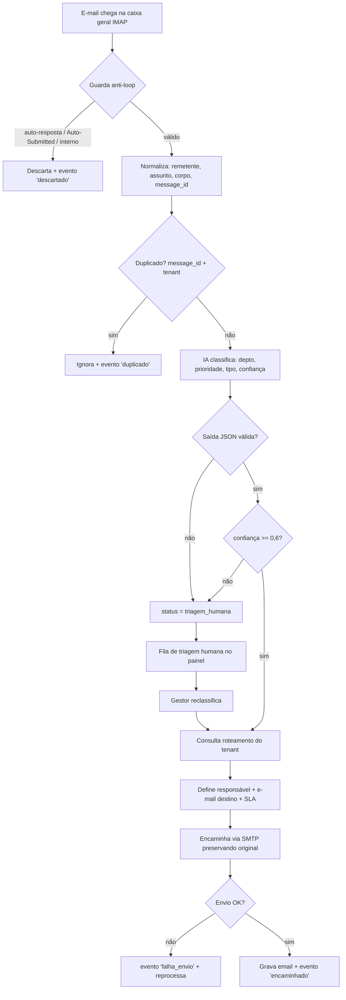

# App Flow — ÍRIS

| Campo | Valor |
|---|---|
| Documento | App Flow (jornada, estados e fluxos) |
| Versão | 1.0 · 09/10/2026 |
| Referências | PRD ÍRIS v1.0 · documento-mestre v0.1 (§5, §9, §10) |

> A ÍRIS não tem telas de usuário final: é um serviço de servidor. O "fluxo" é a **jornada de cada e-mail** pelos workflows do n8n e os **estados** que ele percorre. Os workflows detalhados estão no mestre §9.

## 1. Jornada do e-mail (fluxo principal — UC-01)

## 2. Estados do e-mail

`recebido → classificado → (encaminhado | triagem_humana) → resolvido`

| Estado | Entra quando | Sai para |
|---|---|---|
| `recebido` | captado pelo IMAP e normalizado | `classificado` ou `triagem_humana` |
| `classificado` | IA retornou saída válida com confiança ≥ 0,6 | `encaminhado` |
| `triagem_humana` | saída inválida ou confiança < 0,6 | `classificado` (após reclassificação) |
| `encaminhado` | *forward* enviado ao responsável | `resolvido` |
| `resolvido` | marcado pelo responsável/coordenação `[A CONFIRMAR como]` | — |

Transição não prevista é **recusada antes de gravar** (regra ARKHEN). Correções nunca apagam: geram novo evento em `eventos_email`.

## 3. Workflows n8n (mestre §9)

| Workflow | Gatilho | O que faz | RF | Fase |
|---|---|---|---|---|
| 01 — Recepção e encaminhamento | IMAP | captura → anti-loop → IA → valida → roteia → encaminha → registra | RF-001..005,009 | 2–3 |
| 02 — Monitor de SLA | Cron 15 min | lê `vw_sla` + abertos → alerta vencidos → evento `alerta_sla` | RF-006,102 | 4,6 |
| 03 — Relatório diário | Cron 07:00 (America/Sao_Paulo) | agrega → monta e-mail (barras/linhas ARKHEN) → envia à lista | RF-008 | 6 |
| 04/05 — Semanal e mensal | Cron | mesmo padrão, janelas maiores | RF-101 | 7 |

## 4. Tabela ação × destino (painel)

| Onde | Elemento | Ação | Destino |
|---|---|---|---|
| Metabase | Dashboard executivo | abrir | KPIs do dia (mestre §12) |
| Metabase | Dashboard operacional | abrir | filas, pendências, SLA |
| Metabase | Fila de triagem humana | reclassificar | volta o e-mail ao roteamento |
| E-mail | Relatório diário | receber 07:00 | resumo para a lista configurável |

## 5. Estados de exibição (painel)

Cada painel tem os 4 estados: **carregando**, **vazio** ("sem e-mails no período"), **erro** (falha de consulta, com `requestId`), **sucesso**. Mestre §12 define os gráficos.
