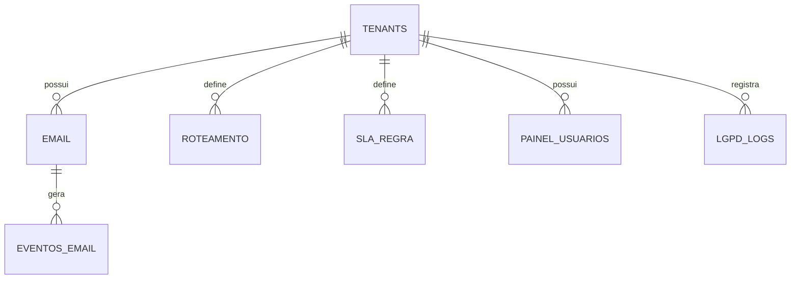

# Esquema do Backend — ÍRIS

| Campo | Valor |
|---|---|
| Documento | Esquema do Backend (dados, RLS, usuários) |
| Versão | 1.0 · 09/10/2026 |
| Referências | PRD ÍRIS v1.0 · TRD v1.0 · documento-mestre v0.1 (§7, §8) · Manual ARKHEN 6, 7.1, 8.3 |

> O DDL-base e as views estão no documento-mestre §8. Este documento é o **esquema consolidado com a decisão multi-tenant (ADR-0006)**: acrescenta `tenants`, `tenant_id NOT NULL` e **RLS forçado** em toda tabela de negócio, define usuários por privilégio e políticas. Não há auth de usuário final (login social/JWT do modelo genérico **não se aplica** — o acesso é Metabase + n8n, protegidos por VPN/MFA).

## 1. Convenções (padrão ARKHEN)

- `snake_case`; **português no domínio**; `id uuid` PK; `timestamptz`.
- **Multi-tenant:** `tenant_id uuid NOT NULL` + `FORCE ROW LEVEL SECURITY` em toda tabela de negócio, sem política permissiva, com testes de isolamento no CI.
- `eventos_email` e `lgpd_logs` são **append-only** (sem `UPDATE`/`DELETE`). Tempo deriva de eventos — **nenhum campo de duração**.
- Migrações rodam com `iris_owner` (nunca superusuário); o n8n conecta com `iris_app` (DML, sem DDL); o Metabase com `iris_ro` (leitura).

## 2. Acesso e autenticação (não há login de usuário final)

- **Metabase:** login próprio do Metabase + **MFA**; cada tenant com grupo/usuário que só enxerga os seus dados (via `iris_ro` + RLS pelo `tenant_id` do tenant).
- **n8n:** administração restrita por **VPN/allowlist de IP + MFA**; nunca porta pública além do 443 (Nginx).
- **Credenciais IMAP/SMTP/IA:** no `.env`, fora do Git; `N8N_ENCRYPTION_KEY` definida; rotação periódica.

## 3. Diagrama de relacionamentos



## 4. Tabelas (DDL consolidado com multi-tenant)

```sql
-- Cliente (controlador). Configuração por tenant: setores, marca, retenção, limiar.
CREATE TABLE tenants (
    id             uuid PRIMARY KEY DEFAULT gen_random_uuid(),
    nome           varchar(150) NOT NULL,
    configuracao   jsonb NOT NULL DEFAULT '{}',   -- setores, limiar_confianca, retencao_dias, marca
    ativo          boolean NOT NULL DEFAULT true,
    created_at     timestamptz NOT NULL DEFAULT now(),
    updated_at     timestamptz NOT NULL DEFAULT now()
);

-- Usuários do PAINEL por tenant (gestor/leitura). Não é usuário final do produto.
CREATE TABLE painel_usuarios (
    id            uuid PRIMARY KEY DEFAULT gen_random_uuid(),
    tenant_id     uuid NOT NULL REFERENCES tenants(id) ON DELETE restrict,
    nome          varchar(100) NOT NULL,
    email         varchar(255) NOT NULL,
    papel         varchar(20) NOT NULL,          -- gestor | leitura
    ativo         boolean NOT NULL DEFAULT true,
    UNIQUE (tenant_id, email)
);

-- Registro do e-mail (status reflete o estado atual)
CREATE TABLE email (
    id                uuid PRIMARY KEY DEFAULT gen_random_uuid(),
    tenant_id         uuid NOT NULL REFERENCES tenants(id) ON DELETE restrict,
    protocolo         varchar(50) NOT NULL,
    message_id        varchar(255) NOT NULL,       -- dedup por (tenant_id, message_id)
    data_recebimento  timestamptz NOT NULL,
    remetente         varchar(255) NOT NULL,
    assunto           text,
    corpo_ref         text,                        -- ponteiro/hash/trecho mínimo (PD-08: não guardar integral)
    departamento      varchar(100),
    responsavel       varchar(100),
    email_destino     varchar(255),
    prioridade        varchar(20),                 -- critica | alta | media | baixa
    tipo_solicitante  varchar(50),
    sla_minutos       integer,
    palavras_chave    text,
    score_ia          numeric,
    status            varchar(30) NOT NULL,        -- recebido|classificado|triagem_humana|encaminhado|resolvido
    UNIQUE (tenant_id, protocolo),
    UNIQUE (tenant_id, message_id)
);

-- Log de eventos append-only e IMUTÁVEL (fonte da verdade do tempo)
CREATE TABLE eventos_email (
    id            uuid PRIMARY KEY DEFAULT gen_random_uuid(),
    tenant_id     uuid NOT NULL REFERENCES tenants(id) ON DELETE restrict,
    email_id      uuid NOT NULL REFERENCES email(id) ON DELETE restrict,
    tipo_evento   varchar(40) NOT NULL,            -- recebido|classificado|encaminhado|falha_envio|alerta_sla|resolvido|reclassificado|descartado|duplicado
    ocorrido_em   timestamptz NOT NULL DEFAULT now(),
    detalhe       jsonb
);

-- Roteamento (dado, nunca if no código)
CREATE TABLE roteamento (
    id             uuid PRIMARY KEY DEFAULT gen_random_uuid(),
    tenant_id      uuid NOT NULL REFERENCES tenants(id) ON DELETE restrict,
    departamento   varchar(100) NOT NULL,
    responsavel    varchar(100) NOT NULL,
    email_destino  varchar(255) NOT NULL,
    palavras_chave text,
    ativo          boolean NOT NULL DEFAULT true
);

-- SLA por prioridade, por tenant
CREATE TABLE sla_regra (
    id          uuid PRIMARY KEY DEFAULT gen_random_uuid(),
    tenant_id   uuid NOT NULL REFERENCES tenants(id) ON DELETE restrict,
    prioridade  varchar(20) NOT NULL,              -- critica|alta|media|baixa
    minutos     integer NOT NULL,
    UNIQUE (tenant_id, prioridade)
);

-- Log LGPD imutável
CREATE TABLE lgpd_logs (
    id          uuid PRIMARY KEY DEFAULT gen_random_uuid(),
    tenant_id   uuid NOT NULL REFERENCES tenants(id) ON DELETE restrict,
    ocorrido_em timestamptz NOT NULL DEFAULT now(),
    acao        varchar(60) NOT NULL,
    ator        varchar(120),
    detalhe     jsonb
);
```

## 5. Views de duração (nunca coluna de duração)

Do mestre §8 — recalibradas com `tenant_id`:

```sql
CREATE VIEW vw_tempo_resposta AS
SELECT e.tenant_id, e.id, e.protocolo, e.prioridade,
       r.ocorrido_em - e.data_recebimento AS tempo_resposta
FROM email e
JOIN eventos_email r
  ON r.email_id = e.id AND r.tipo_evento = 'resolvido';

CREATE VIEW vw_sla AS
SELECT v.tenant_id, v.id, v.protocolo, v.prioridade, v.tempo_resposta,
       (v.tempo_resposta <= make_interval(mins => s.minutos)) AS dentro_do_sla
FROM vw_tempo_resposta v
JOIN sla_regra s ON s.tenant_id = v.tenant_id AND s.prioridade = v.prioridade;
```

## 6. RLS (Row Level Security) — forçado

Aplicar em **todas** as tabelas com `tenant_id`. Padrão:

```sql
ALTER TABLE email ENABLE ROW LEVEL SECURITY;
ALTER TABLE email FORCE ROW LEVEL SECURITY;         -- vale até para o dono
CREATE POLICY email_tenant ON email
  USING (tenant_id = current_setting('app.tenant_id')::uuid);
-- repetir para: painel_usuarios, eventos_email, roteamento, sla_regra, lgpd_logs
```

O `app.tenant_id` é definido por sessão (o n8n e o Metabase setam o tenant corrente antes de consultar). Nenhuma política permissiva (`USING (true)`).

## 7. Índices, retenção e LGPD

- **Índices:** `email(tenant_id, status)`, `email(tenant_id, data_recebimento)`, `eventos_email(tenant_id, email_id)`, `roteamento(tenant_id, departamento)`.
- **Dedup:** `UNIQUE (tenant_id, message_id)` em `email`.
- **Testes de isolamento (CI):** tenant A não lê, altera nem apaga nada do tenant B — em cada tabela.
- **Retenção:** por `tenants.configuracao.retencao_dias` `[A CONFIRMAR: 90 dias + anonimização — PD-07]`; registros de acesso 6 meses (Marco Civil).
- **Minimização (PD-08):** avaliar **não** gravar `corpo_ref` com o conteúdo integral — só hash/trecho/ponteiro cifrado.
- **Inventário LGPD:** cada coluna com dado pessoal em `docs/lgpd/inventario-dados.md`; RIPD em `docs/lgpd/ripd-iris.md`.
